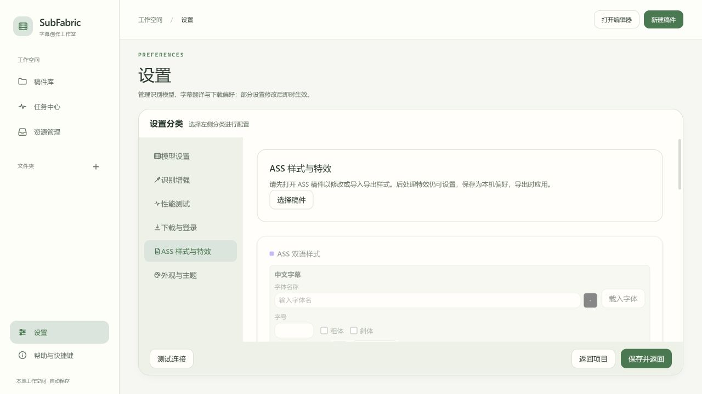

# 新 UI 生产接线

2026-10-13 用户要求：将完成的桌面原型替换为默认生产界面，连接真实功能，功能不漏，补齐设置中的 ASS 样式。后续已将旧界面视觉迁移为 `SubFabric Classic` 主题包并删除旧入口代码。

## 实施约束

- `editor/studio.html` 是唯一生产模板；旧 `editor/index.html`、`css/style.css`、`css/ui.css` 已删除。核心编辑/项目逻辑继续复用真实模块与事件绑定，不引入演示项目或虚假进度。
- 新增 `editor/studio.html` 与独立外观/导航适配模块，沿用原生 ESM，无 npm/前端构建步骤。
- 根目录 `ui-config.json` 仅保留历史兼容读取；无论缺失、损坏、`new` 或 `legacy`，根入口都进入 `editor/studio.html`。`/index.html` 与旧书签只做兼容重定向。
- ASS 双语字体、字号、粗斜、主/备用色、逐词高亮、上下顺序、未唱色、k/kf、原始样式预设导入导出与后处理全部复用编辑器真实控件。全局设置不再放置 ASS 分类，避免将当前稿件功能混入全局识别配置。
- 项目加载原子性、ETag 保存冲突、模型生命周期、媒体播放、字幕标签保真、安全静态白名单保持。
- 只在源码仓库改代码；当前安装版另行比较基线后才能做有回滚的更新，不整体同步安装目录。无云端发布操作。

## 阶段与验收

1. 记录相关源码哈希，核对原 UI 功能入口。
2. 实现新入口/配置选择，新的导航、稿件库、创建、任务、资源、设置与独立编辑工作区接线。
3. 保留所有原 DOM id、输入选项、动态控制与对话框；新导航新增功能使用实际状态和已有接口。
4. 新旧入口资源图、配置异常回退/白名单安全、ASS 预设、并发保存、原子加载、首页进度等回归。
5. 独立临时服务和合成稿件浏览器验证：页面切换、编辑保存刷新、ASS 样式预览/导出、主题/背景、任务与资源实际入口。真实 GPU/在线识别不能用模拟验证冒充。

状态：已完成且已验证。Studio 模板保留全部真实控件、选项及资源引用；旧 HTML/CSS/UI 已删除。`editor/js/main.js` 保留真实编辑链路，并由逐词时间任务接入共享的字母加权分配器。首页进度、原子加载、ASS 预设、并发保存及静态白名单回归通过。隔离桌面服务已打开真实编辑链路，合成 ASS 的 60 行/120 句、波形与 libass 正常，1280×720 无横向溢出、控制台无 error/warn。

最新审查修复已通过 `studio-navigation-test.mjs`：设置/资源返回目标、新建材料保留、直开编辑器初始化、上传期间 6 种导航互斥、无项目时禁用 ASS 文档操作；字体颜色保存到当前项目，后处理特效为本机偏好并在导出时应用。3 个内存反向探针能检出旧行为。

安装候选隔离浏览器已验字号 72→71 保存/刷新重开、样式预设导出、Material You/深色/流光刷新保留、取色器自定义 #4867A1。实际播放器运行 wave=true、暂停 wave=false；全部 error/warn 为空。当前服务 12 项目/0活动任务。SEA 启动器读取外置 server.js，无需重建；`tools/studio-install.mjs` 仅给安装版合并本次 server/project/timeline/lang 差异与新增资源，保留其他安装代码。

## 已安装与回退

### 下载与登录表单间距（2026-10-14）

画质与代理、Cookie文本框与操作按钮原为独立grid/row，相邻容器无行间距；仅该分类的卡片直接相邻表单行增加12px。单个studio.css事务实装，备份 `update-backups/ui-fetch-spacing-20261014/`。候选入口完整性通过；隔离Studio浅色/Material深色及真实1280×720均测得12px、无横向溢出/控制台错误。37资源/12稿件/保护哈希核对通过；不保存/清除Cookie或测试真实登录下载。云端原子提交仍阻塞。

### 焦点、品牌与设置页滚动（2026-10-14）

日志三个子页沿用原切换事件，统一为主题分段按钮；焦点框内绘，品牌留白移到链接外。唯一版本节点移至 SubFabric 名称旁，继续显示后端真实版本，不在稿件库、任务或文件夹标题重复。

Studio 设置以整页为唯一滚动区，分类切换复位页面滚动，末卡保留底部空间；原返回/保存动作仍是 st-box 直接子元素和原监听器，定位标题右侧，返回使用强调色。

三前端文件事务实装，备份 `update-backups/ui-focus-settings-layout-20261014/`；生成器与 JS 镜像同步。导航、源码/候选入口完整性（571 控件、37 资源）、JS 语法通过；隔离两主题及 1280×720、1024×640 桌面检查无横向溢出。实际8321核对焦点/完整底卡/品牌版本/日志三页与返回编辑器入口，无 error/warn；37资源哈希一致，12稿件与安装时保护配置未变化；后续复核单列一个稿件17:07:16的运行后数据变化，保留现状。不运行真实ASR/LLM/下载，不构建安装包；ESLint无可用包未运行，GitHub原子提交能力仍阻塞。

### 命名翻译方案与识别系列（2026-10-14）

用户要求：翻译与术语默认留空，仅显示已保存方案；添加时填写名称、厂商/API、模型、术语表等。语音识别以 Whisper / Parakeet / 云端 / 前置大卡片进入细分，VibeVoice 作为可进入的 CUDA 4bit 系列；移除全局“编辑与工作台”，编辑器入口保留。

已完成且已验证并实装。命名方案与服务商预设分开：服务商只在表单选择，方案独立保存调用配置、术语与提示词，支持修改、删除、选用和保存后使用；初次空列表不删除原翻译配置。后端密文保存 Key，响应只返回 hasKey；草稿连接测试不写入也不切换。全局热词保存不会覆盖翻译草稿，原配置接口保留。展开使用自然高度 grid 动画，关闭后 inert，兼容减少动效；无新增动画循环。

分类理由：先选引擎系列再看硬件模型，减轻长列表负担；Parakeet 三种硬件模型为主，多说话人/双引擎收进“其他识别模式”，功能不丢。运行环境、下载位置、重新识别默认模型及说话人分离归前置；依赖安装仅由显式按钮触发。编辑/播放/文件/导出/自愈及 ASS 始终留在稿件编辑器，避免重复配置入口。

隔离 `translate-schemes-test` 已验 CRUD、独立 Key/模型/术语、选用、清除 Key、非法字段/重名拒绝、测试不落盘及旧配置覆盖兼容；扩展 `studio-navigation` 已验空列表、名称/厂商必选、失败保留、成功清除明文、取消、两方案切换/删除、无 localStorage 凭证、系列返回/禁用卡与常驻编辑器组。`ui-integration` 571旧控件/37资源和生成模板通过。源码及安装候选分别验证，保留两者原有差异；备份/候选/安装清单在工作区 `update-backups/ui-settings-schemes-families-20261014/`。真实 GPU/ASR/LLM 及下载未作为验收运行。

事务安装五文件（studio.html/studio.css/studio.js/project.js/server.js），正常退出后重启原 EXE，安装前确认所有稿件后台任务、模型下载和性能测试为空。两次真实8321检查37资源/磁盘/清单一致，12稿件、EXE/原UI/配置/项目保护哈希不变。浏览器实际已验空列表、6分类/5系列卡片、编辑器五组设置与自愈原位、1280px无溢出及error/warn为空；隔离验收还覆盖保存刷新/English术语/Studio浅色与Material深色、70词条表单内容高度一致无硬截断。截图 `settings-live.jpg`。不构建安装包，不重复配置旧UI开关；离线ESLint未执行（无现成包）。GitHub保存仍受expected-HEAD写入能力与gh缺失阻塞，见STATUS。

### Studio 选择栏统一（2026-10-14）

已完成且已验证并实装。默认Studio主题的选择栏启用既有自定义菜单行为，外观单独设计：表面色背景、1px细描边、8px按钮圆角、10px轻阴影菜单、6px选项圆角及淡色选中勾选。常规设置38px高，编辑器和稿件卡片32px；播放器倍速使用同样的32px按钮和10px菜单，字体面板同步材质。Material仍沿用14px按钮和16px菜单的柔软轮廓。两主题继续支持真实值/原change事件、动态选项、禁用项、键盘与焦点恢复，无新增动画循环、计时器或依赖。

菜单安装函数更名为installThemeChoices，支持Studio和Material；主题切换收起菜单，不重建业务控件。st-grid和sm-model字段读取可见标签以补齐可访问名称。Node语法、ui-integration（571控件/37资源）及扩展studio-navigation通过；新增Studio键盘选择、Escape/焦点恢复、禁用状态、真实倍速更新、标签和重复扫描回归。单个studio.js测试镜像逐字节一致。

真实8321浏览器检查Studio浅/深色菜单可读，计算按钮8px/菜单10px/选项6px；Material切回仍16px菜单。空编辑器的倍速按钮32px、菜单10px，12张稿件卡片均为32px高/8px圆角，点击菜单不打开稿件；1280px无横向溢出，error/warn为空。验收后恢复Studio浅色主题并保留运行页；未建立额外服务，未执行真实ASR/LLM。

仅事务安装studio.css/studio.js，原件/候选/清单在工作区 `update-backups/ui-studio-choices-20261014/`（installed）。37个HTTP资源与磁盘一致，安装清单和8项保护哈希通过，默认新入口及配置隐私通过，本轮未重复切换旧UI配置。云端仍受expected-HEAD接口与约定CLI缺失阻塞，见STATUS；旧入口文件和项目/识别设置未改。

### 全页面选择栏与稿件搜索（2026-10-14）

已完成且已验证并实装。Material菜单作用域扩展到新入口全部单选select，补齐稿件库/任务中心卡片中的文件夹分配、资源管理和新建配置；倍速保留专用菜单，多选与原生列表框保持自身行为。动态匿名选择框生成唯一按钮ID，保留原select身份；点击按钮阻止冒泡，避免打开包含它的稿件卡片。文件夹选择框保持全宽，卡片按钮用36px高度；菜单共用既有主题色、圆角、选中勾选和鼠标/键盘操作。Studio继续显示原选择框。

稿件库和任务中心共用的搜索框改为44px高、999px胶囊圆角、主题表面色及13px文字；常态主题描边、悬浮加深，焦点用主题色边框和1px内描边加粗，尺寸不跳动。筛选按钮也使用胶囊形状与选中描边，减少动效规则继续生效，无新增动画循环、计时器或依赖。

语法、ui-integration（571控件/37资源）及扩展studio-navigation通过；新增行为验收覆盖新建/资源选择、匿名动态卡片ID唯一、阻止点击冒泡、原生change业务事件、文件夹改名同步与卡片移除关闭菜单，测试镜像一致。真实浏览器确认12张稿件卡片使用统一菜单，点击不误打开稿件；搜索无匹配/清空恢复，任务中心共享44px/999px搜索样式，资源模型菜单16px圆角且在1280px视口内，全局下载选择栏一致。运行DOM45个菜单ID唯一，单选覆盖无遗漏，无横向溢出，error/warn为空；验收后恢复原Studio主题。

仅事务安装studio.css/studio.js，原件/候选/清单在工作区 `update-backups/ui-global-choices-20261014/`（installed）；8321的37资源与安装磁盘一致，清单与8项保护哈希通过，默认新入口及配置隐私通过，本轮未重复切换旧UI配置。复用现有验收工具并在内存适配安装根目录/清单格式，工具源码未改。未修改项目/全局识别设置，未建立临时服务。云端提交仍受缺少expected-HEAD写入接口与约定CLI缺失阻塞，恢复入口见STATUS。

### Material You 播放条与选择栏（2026-10-14）

已完成且已验证并实装。播放轨道和音量轨道统一8px，波浪同步加粗，播放滑块20px、时间读数13px。字幕角色筛选/显示模式、编辑器设置、全局设置和设置抽屉中的select统一为主题圆角菜单；主题表面色、选中勾选、悬浮状态和短弹出动效沿用Material外观，字体选择面板也同步材质。Studio保留原生选择框。

原select的ID、选项、值和业务change事件保留；支持方向键/Home/End、Enter/空格、Escape/Tab、首字母搜索、外部点击关闭、禁用选项/optgroup、动态选项和主题/路由变化。不新增依赖、动画帧循环或轮询。studio-navigation增加生产适配器回归，覆盖原生change、键盘、禁用项、动态同步与主题切换；相关语法和ui-integration（571控件/37资源）通过，studio.js单个测试镜像逐字节一致。

隔离浏览器已实测角色筛选、双语显示切换和ASS上下顺序写回，播放轨道8px/滑块20px/读数13px、深色菜单及1280px无横向溢出，空格选择不误触播放。安装后8321的37个HTTP资源与磁盘一致、清单哈希一致、8项保护文件不变；配置隐私及旧/新入口切换后恢复通过。现有verify-studio-live的固定根目录和历史清单形状不适配本轮，复用原检查逻辑在内存适配后通过，未修改工具源码。运行版圆角菜单和显示模式菜单已检查，error/warn为空，验收后恢复原Studio主题。

仅事务替换studio.css/studio.js，原件、候选和清单在工作区 `update-backups/ui-material-selects-20261014-9f284ff5/`（installed）。2586临时服务和验收标签页已关闭，实际程序8321及独立原型8347保留。当前页面刷新后可使用；本轮尚未提交GitHub，阻塞与恢复入口见STATUS。未运行真实GPU/ASR/LLM。

### 编辑器页签字号（2026-10-14）

已完成且已验证并实装。字幕/角色/设置/日志统一11px→14px，仅增加生产Studio的panel-tabs作用域规则，不调整其他字体或布局。8321空编辑器四个DOM页签计算字号均14px，角色仍按原逻辑在无项目时隐藏；可见页签clientWidth=scrollWidth，无文字溢出，文档/视口1280px。纯CSS修改未新增测试或重复媒体回归。仅事务安装studio.css，备份/候选/清单在工作区 `update-backups/ui-editor-tabs-20261014-9abf0e01/`（installed），运行CSS/磁盘/清单一致，八项保护哈希不变。临时验收页已关闭，当前稿件页刷新即可生效；云端既有阻塞仍见STATUS。

### 隐藏面板分隔线（2026-10-14）

已完成且已验证并实装。仅在生产Studio作用域隐藏hsplit/vsplit的装饰伪元素，悬浮也不出现；保留分隔DOM、布局间隙和原main的bindSplit监听器。运行版空编辑器确认横区8px/纵区6px、pointer-events:auto、row-resize/col-resize，两个伪元素display:none，视觉无两条装饰线。纯CSS改动未新增测试或重复媒体回归。仅事务更新studio.css，备份/候选/清单在工作区 `update-backups/ui-hidden-dividers-20261014-d7c85e7a/`（installed）；8321CSS/磁盘/清单一致，八项保护哈希不变，旧UI/拖动逻辑未修改。临时验收标签页已关闭；当前稿件页刷新即可生效，云端阻塞仍见STATUS。

### 编辑器背景跟随设置（2026-10-14）

已完成且已验证，并实装。编辑器沿用全局body的背景/主题色/明暗/动效偏好；工作区定位在全局背景上方，流光/图片模式仅将工具栏、预览外壳、字幕面板和时间轴外壳改为78%主题表面材质，纯色模式仍实色。字幕卡、吸顶标题、媒体黑边及时间轴canvas保持原绘制；布局和真实媒体逻辑不变。不额外复制背景图片或新增模糊滤镜，非流光模式隐藏流光层，减少动效继续使用既有规则；无新增JS循环、计时器或依赖。

隔离合成媒体浏览器验证Studio浅色流光、Material深色图片/流光、图片背景刷新后保留、切回纯色恢复实色与backgroundImage:none、减少动效animation:none；1280px无横向溢出。ui-integration（571控件/37资源）通过；隔离libass首次隐藏阶段有一次零尺寸resize提示，实际安装设置页刷新error/warn为空。仅事务安装studio.css，原件/候选/清单在工作区 `update-backups/ui-editor-background-20261014-af77296d/`（installed）。真实8321CSS/磁盘/清单一致，EXE、旧UI、配置和设置八项保护哈希不变。临时验收服务和页面已关闭，8321实际程序及8347原型保留；已有稿件页刷新即可使用。云端尚未提交，既有阻塞见STATUS。

### Material You 播放控件（2026-10-14）

最新图标与菜单修整已完成且已验证，并实装。播放 SVG 原本继承 `.btn .ico` 的文字间距，现清除该留白；音量 SVG 的可见形状中心按 viewBox 校正。Material 播放按钮由48px改为40px，前后跳转宽28px/高36px，独立按钮组间距2px、实测总宽100px。倍速改为自定义主题菜单，外框16px圆角、选项10px圆角、主题表面/强调色用于底色和悬浮/焦点，带选中勾选；使用既有pop-in动效与减少动效规则，无新增动画循环、计时器或依赖。Studio 保留原生 select。

菜单支持鼠标、方向键/Home/End、Enter与空格、Escape焦点恢复、Tab离开、外部点击及导航/尺寸/主题变化关闭；捕获阶段的播放器空格拦截通过菜单内显式选择处理兼容。选项写入原select的change链路，外部ratechange同步标签及aria-checked。生产适配器回归新增当前选项聚焦、嵌套标签点击、真实速度更新/外部同步、键盘循环/退出/空格选择和内外点击关闭，原导航/上传/进度行为继续通过；Node语法及ui-integration（571控件/37资源）通过，单个studio.js测试镜像一致。

隔离浏览器实测浅深色菜单、鼠标1.5×、End/Enter2×、方向键/空格1.25×且视频仍暂停、Escape焦点恢复；播放/音量SVG与按钮中心偏差均0/0，播放暂停与静音视觉已检查，1280px无横向溢出。切回Studio时原select显示、自定义菜单隐藏、播放栏42px。隔离libass首次隐藏阶段有一次零尺寸resize提示；真实安装设置页刷新error/warn为空。仅事务替换studio.css/studio.js；备份/候选/清单在工作区 `update-backups/ui-player-refine-20261014-269bf2c3/`，状态installed。真实8321资源去缓存戳后与磁盘/清单一致，八项保护哈希不变；临时验收服务及标签页已关闭。未测试真实长视频/GPU/ASR/LLM，尚未提交GitHub（云端阻塞见STATUS）。当前稿件页刷新即可加载。

后续焦点框调整已完成且已验证并实装：Material 播放条取消方形 outline，使用独立伪元素绘制 999px 胶囊边框，轨道与拖动几何不变；鼠标与键盘焦点共用同一轮廓，失焦隐藏，pointer-events:none，不新增 JS 或动画。独立浏览器加载真实生产 CSS 验证点击/Shift+Tab/失焦及外观；仅安装 studio.css，真实8321/磁盘/源码哈希一致，单文件备份/清单在工作区 `update-backups/ui-seek-capsule-20261014-bc9048fe/`。无需为纯CSS调整重复媒体回归；本轮独立验收页和服务收尾关闭。

已完成且已验证，并已实装。Material You 编辑器播放按钮改为演示版的实心不对称圆角轮廓，播放时切为圆角暂停形态；左右增加后退/前进 10 秒，提示文案明确秒数。定位限制在 0–duration，连点以待完成的跳转目标累加，避免长视频解码迟到导致定位回退。只在有媒体及有效时长时启用。

Material 音量采用主题色填充轨道、圆形滑块和圆形静音按钮；倍速选择器使用描边圆角与定制下箭头，保留原生 select 的键盘与辅助技术语义。支持 0.25–2×，真实 volume/mute/playbackRate 事件同步显示；无新增依赖、动画循环或计时器。样式按 Material 作用域应用，Studio 跳转按钮隐藏、原 42px 播放栏保持；Material 为 56px 控件区，旧布局与时间轴不变。

验证：Node 语法、语言 JSON、ui-integration（571 控件/37 资源）、扩展 studio-navigation 通过。新增实际适配器回归覆盖十秒跳转、起止钳制、待解码目标连点、即时读数、无媒体禁用、音量填充/零音量静音/解除静音及实际倍速写入，原拖动/悬浮/导航继续通过；单个 studio.js 测试镜像同步。隔离浏览器实测 0→10→0 秒、音量 0.35/填充35%、倍速1.5×、运行 wave=true/暂停轮廓，进度条余宽约345px，文档与视口均1280px；切回 Studio 的跳转按钮 display:none、播放栏42px。隔离 libass 有一次隐藏阶段零尺寸 resize 提示，与此前同类记录；不将隔离会话宣称为全程无错误。真实安装版已刷新，卡片/控件模块载入及 error/warn 为空。

仅事务安装 studio.css、studio.js、zh-CN.json；备份/候选/哈希清单在工作区 `update-backups/ui-material-player-20261014-f9219acf/`。真实8321三资源去缓存版本戳后与磁盘/清单一致，EXE、旧 index/main/style/ui/video-hover-tip、配置与设置八项哈希保持。未运行真实长视频/GPU/ASR/LLM；本轮临时验收页与服务在收尾关闭，实际程序与独立原型保留。刷新已打开的稿件页即可使用。

### 播放条与主题示意图（2026-10-14）

后续四处反馈已完成且已验证，并安装到当前运行版。播放条 input 先同步填充与时间标签，再请求媒体跳转；拖动及解码等待期间保留目标时间，迟到 timeupdate 不拉回滑块。释放/取消/失焦、seeked 与媒体加载重置有对应收尾。只使用原生 range 与事件，没有增加动画帧循环、计时器或媒体副本。

新入口不再加载原生轨道专用 video-hover-tip.js；同一提示节点移到新播放条，按真实轨道宽度显示悬浮时间，离开/开始拖动/路由与尺寸变化时收起，不改视频 currentTime。旧入口及其专用提示模块保持原样；生成工具同步该入口差异。

外观页取色器包装改为透明并为焦点轮廓留边，消除圆角输入框外的方形底色。主题包卡片恢复演示版的浅色工作区、Studio 方块图标、Material 花瓣/星光、三条内容横条及选中勾选；缩略图按包种子计算浅色色板，深色设置页也清晰。

相关语法、ui-integration（571 旧控件/37 资源）及扩展 studio-navigation 通过。后者新增即时填充/时间、迟到媒体进度、释放后等待、键盘、悬浮无跳转、取消及媒体重置行为回归。隔离桌面浏览器实际拖动 35%→81.07%（9.7284 秒）、键盘 25%→25.01%（3.0012 秒）；新轨道悬浮显示 00:00:06 且不改变媒体位置，旧区域提示隐藏。两主题与浅/深色外观边缘和卡片已查看，包装背景透明、文档/视口均为 1280px，无横向溢出。实际安装版已刷新并核对卡片/提示归属及 error/warn 为空；未用真实长视频/GPU/在线 ASR/LLM 冒充验收。

本次只事务替换 studio.css、studio.js、studio.html 三个前端文件，安装前基线相同。备份、候选、回退原件及哈希清单在工作区 `update-backups/ui-seek-theme-20261014-b553534b/`；真实 8321 三资源去服务 build-stamp 后与磁盘/清单一致。EXE、旧 index/main/style/ui/video-hover-tip、配置及设置八项哈希保持。生产 studio.js 测试镜像同步；本轮临时服务与验收标签页已关闭，实际程序及独立原型继续运行。刷新现有页面即可使用。

### 2026-10-14 UI 修整

五处截图反馈已完成且已验证，并安装到当前运行版：倾斜统计块使用完整胶囊圆角并避免被父布局拉伸；新界面两主题关闭原生 video controls，只保留一套自定义播放器，并补齐音量、静音和 0.25–2× 倍速；Material You 波浪的 SVG 图案路径延伸至瓦片边界外，消除重复接缝，暂停仍显示直线；角色总览固定两列、长名省略，单击分配/右键修改保留；外观设置行使用主题表面和文字变量，浅色不再出现黑底。

继续使用既有 CSS 波浪动画与可见性生命周期，没有新增 JS 动画帧循环或计时器。生成工具同步去除 Studio 入口的原生 controls。

验证：相关 Node 语法与语言 JSON 校验、ui-integration（571 旧控件/37 资源）、studio-navigation 均通过；测试夹具补齐 toggleAttribute，单个 studio.js 镜像与生产源码哈希一致。隔离桌面浏览器验证两主题单播放器、Material 播放波浪/暂停直线、35% 拖动至 4.2 秒、音量/静音/倍速、角色两列与单击/右键操作；角色列实测各 185px。Material 首页胶囊实测 98×130px、圆角 999px、align-self:center，文档/视口均为 1280px，无横向溢出。隔离会话曾记录一次 libass 初始隐藏阶段的零尺寸 resize 提示，不能把该会话声明为全程无错误；实际安装版浅色外观页核验 error/warn 为空。本轮隔离验收标签页和临时服务已关闭，真实 8321 与独立原型继续运行。

实装只更新 `editor/css/studio.css`、`editor/js/studio.js`、`editor/studio.html`、`editor/lang/zh-CN.json`。安装前四文件均与本轮源码基线相同；备份及候选在工作区 `update-backups/ui-touchups-20261014-UV9M1y/`。事务替换及真实 8321 四资源/清单哈希通过，EXE、旧 HTML/main/style/ui、配置及设置七项保护哈希不变。未构建安装包、未测试真实 ASR/LLM；已有页面刷新即可加载本轮修复。

已安装当前 2.4.0，原 EXE 启动成功、libass 正常。12 文件包含默认配置与示例配置；源码与安装旧 HTML/CSS/main 各自原哈希保持，EXE、用户设置及 12 项目核心文件未变。原文件和候选/哈希清单在工作区 `update-backups/ui-wiring-20261013-Q8KCxT/`。第一次后置校验漏记根目录示例配置，自动回滚后逐文件核对原哈希及新增文件清理通过；补齐校验范围后成功安装。新增文案已补入源码/安装语言文件，原安装译文优先保留。

历史程序根目录 `ui-config.json` 示例为：

```json
{"ui":"new"}
```

该字段现在只为兼容旧安装配置保留，不再切换界面。刷新根地址或打开 `/editor/studio.html#/home` 都进入同一 Studio 生产入口；`{"ui":"legacy"}`、删除或损坏配置均不会恢复旧界面。

## 真实功能映射

| 新界面入口 | 沿用的真实功能 |
| --- | --- |
| 稿件库 / 新建 / 详情 | 原项目 API、视频/字幕/项目包/区域导入、链接解析与下载、初稿识别、逐词/置信度/角色/自动后处理参数、重试、媒体重连 |
| 任务中心 | 真实项目任务快照、原进度/详细信息/重试操作，使用后端现有能力 |
| 设置 | ASR/NeMo/模型与运行时、独立重识别模型、LLM 方案/密钥/术语、热词增强、性能测试、下载与登录；原资源管理入口已合并到设置 |
| 设置 → ASS 样式与特效 | 双语字体/尺寸/粗斜/主备用色、高亮色、上下顺序、k 未唱色/kf、原始样式预设与字体载入、逐词转换、Glow/Grow/Fade 后处理 |
| 独立编辑器四 Tab | 原真实字幕/角色/设置/日志；时间轴/波形/媒体/备注、修复/重识别/逐词重校对/置信度/反思/分段导入、字幕/逐词 JSON/项目包导出及退出 |
| 外观与主题 | Windows 10（默认，内部 `uwp`）/ Material You / SubFabric Classic、自定义主题色、明暗/系统、纯色/流光/本机图片（含 HEIC/HEIF、模糊/压暗）、声明式主题包导入导出、减少动效 |

文件夹只在本机浏览器记录分组关系，不移动实际项目文件；不把原型演示数据混入真实工作区。字体颜色保存到当前 ASS 项目；后处理特效为本机偏好，在预览/导出时应用。无当前 ASS 项目时必须先选择稿件才能修改文档样式。

### 2026-10-15 资源入口合并与 UWP 完整覆盖

用户反馈资源管理和设置实际显示同一页面。已移除 Studio 侧栏“资源管理”入口及设置页重复快捷栏，识别模型、翻译、增强等内容继续由“设置”的现有分类承载；直接打开旧 `#/resources` 书签时由路由转至 `#/settings`，保留原返回路径。生成器模板和生产 HTML 一并维护。

UWP 之前仅有零散控件圆角规则，且后续 Studio 公共 CSS 会重新应用大圆角、悬浮位移和玻璃材质。现补齐最终主题覆盖：Segoe UI 字体、Windows 蓝强调色、紧凑导航/按钮/字段、卡片/弹层/设置分类/选择器/时间轴/播放器等一致的平面表面与 2px 控件几何，并明确压过共用及深色玻璃规则。浅色/深色只切换系统中性色表面，内容组件继续使用同一强调色和对比令牌。

后续自审查又在生产 CSS 最末增加 UWP audit pass，覆盖旧编辑器运行时动态挂载的设置卡、模型卡、方案抽屉、主题预览、编辑器外壳与弹层；同时关闭设置切换/方案抽屉的位移动效，清除共享主题遗留的悬浮抬升和玻璃滤镜，统一 UWP 的 2–4px 几何与平面表面。

按 Windows 10 Fluent 实现规范继续复核后，首页 UWP 视图隐藏营销式 Hero、圆形统计装饰与宽松卡片，把项目管理重点收回标题、筛选、搜索和项目列表；生产主题应用逻辑同步使用规范中的经典蓝和浅/深色中性色令牌。编辑器异常处理按钮改用现有 `icons.js` 单色 SVG，避免 Emoji 在不同 Windows 字体包中产生彩色和基线差异。

回归覆盖侧栏不再暴露资源入口、设置没有重复快捷栏、旧书签重定向和设置返回/保存链路。`node tests/uwp-theme-test.mjs`、`node tests/ui-integration-test.mjs`、`node tests/studio-navigation-test.mjs` 均通过；2026-10-16 完整回归 `node tests/run-all.mjs --report _test/uwp-resource-merge-final-results-20261016.json` 为 87 通过、9 部分执行、1 诊断、0 失败，2 项按环境排除。第一次全量执行中 `repair15-project-pack-test.mjs` 因隔离服务启动超时失败；单项重跑通过，随后完整重跑 0 失败。9 项部分执行来自缺少 `(5)`/项目样本、隔离套件跳过真实浏览器交互、未配置 `SUBFABRIC_PYTHON`；2 项排除项分别需要真实用户项目、真实 GUI 与项目。生成器 `node tools/generate-studio.mjs` 已成功；当前源码快照没有独立 `prototypes/subfabric-ui/themes.js` 时保留已有生产主题模块，生成后 `editor/studio.html` 哈希不变。

### 2026-10-16 浏览器最终复核

Chrome headless/CDP 在隔离端口 `8334` 实际加载生产 Studio 页面并读取 DOM 与计算样式。设置页可选中 Windows 10，`data-design="uwp"` 与 `data-theme-pack="windows-uwp"` 生效；历史浏览器验收记录浅色令牌为 `#f3f3f3/#ffffff`、深色令牌为 `#202020/#2b2b2b`。本轮按 Windows 10 Fluent 规范将生产令牌收紧为浅色 `#F3F3F3/#FFFFFF`、深色 `#1F1F1F/#2B2B2B`，未重新取得截图。侧栏只保留“设置”，设置页没有“资源管理”快捷栏，直接访问 `#/resources` 自动转到 `#/settings`。

### 2026-10-16 浅色毛玻璃参数

设置中的“毛玻璃压暗”“毛玻璃模糊度”“毛玻璃透明度”现在同时计算浅色和深色材质令牌。浅色模式使用独立的半透明黑色表面与 raised 表面，模糊度沿用同一 `backdrop-filter` 参数；这组偏好对 Windows 10、Material You、SubFabric Classic（以及旧自定义 studio 设计包）共享。设置页外壳保持透明工作区，避免设置控件被自身材质遮挡。`ui-integration-test.mjs`、`studio-navigation-test.mjs`、`uwp-theme-test.mjs`、字体选择器回归和完整 JS 回归均通过。

覆盖审查确认 Segoe UI 字体、导航/字段/按钮/编辑器 Tab/播放器/进度条 2px 几何、设置卡 2px（第三轮由 4px 收紧）、平面表面、无 `backdrop-filter` 的 UWP 页面与卡片，以及动态背景透明度（流光 0.2、本地图片 0.16）。运行时版本/依赖提示条也使用 UWP 警告色、细描边、2px 圆角和 Segoe UI。检查后清理了本次隔离浏览器配置与临时副本；真实安装器/SEA、GPU、在线 ASR/LLM 仍未作为本次主题验收运行。

### 2026-10-19 UWP 完整实装（第三轮，设计稿对照）

按 `prototypes/uwp-tiles/` 与 `prototypes/uwp-controls/` 补齐生产层：输入（32px/2px/四边 2px focus）覆盖 `.st-*`/`.np-*`/`#note-input`；复选/单选/开关/range 的 120–140ms 状态与 accent 填充；导航/页签/日志子页签/分段选中态；项目卡 Reveal、状态 badges 行与 34px 封面列表视图；设置分类 8px 短竖条、设置卡 2px；主题包/背景/方案/模型/ASR 卡 3px 左竖条；details 箭头/内容 180ms；Toast/Notice 右下 180/160ms；取色器 2px 与当前色板 `aria-pressed`；字体面板视口夹取；帮助页 `.sf-page` 转场；`--surface-3`、`data-indeterminate`、`data-motion=off` 的 JS 门控。时间轴 canvas 走 `timeline.js` 的 `this.uwp` 分支：2px 播放头无光晕、1px 选中框、hover 1px 外框、块圆角 2px。边界：Tooltip 仍用原生 title（生产无 `data-tip` 控件）；方案抽屉是内联 `.st-scheme-inline` 的 220ms 展开，不是右侧 380px DOM；取色器保留完整双栏；新建页文件行只做常驻虚线视觉，实际拖放仍在视频区。

验证：3 个只读子代理分别审查外壳/设置、编辑器/浮层、控件对照；P0 清零后按报告收口。完整 JS 回归 `_test/uwp-final2-full-20261019.json` 为 94 通过、9 部分、0 失败、2 排除；Edge 1440×960 深/浅色实测首页 label/列表视图/设置卡/编辑器页签/cue 角色条/seek 点击/搜索 focus/帮助页/字体面板均有计算样式证据，页面异常 0。截图在 `_tmp/uwp-final`（未入库）。

用户 5 张截图反馈（2026-10-19）已修：术语表改 2px 分段 + accent-soft/2px 底线 + 虚线添加区/1px 表头；热词模型行标签改横排 nowrap；主题包选中不再整卡 accent-soft 遮罩，改 surface + accent 边框（无 3px 左条）；编辑器设置动态卡 2px；Material You 开关打开态滑块 `translateX(18px)`（mini 16px），右侧空档收至 2px。`uwp-theme-test` 增加 5 组断言；截图 `_tmp/uwp-feedback/`。

主题选择/背景图/文件夹对话框（2026-10-19）：内置主题减为 3 个（UWP 默认 / MY / Classic，Studio 删除）；主题卡按磁贴样式，自定义主题包换 Windows 10 斜向窗户图标。自定义背景图取消 2MB 输入限制（64MB 上限），保存前压到长边 2560 的 WebP/JPEG；HEIC/HEIF 浏览器解码失败时走 `/api/image/convert`（ffprobe 选流 + ffmpeg）。新增背景模糊/压暗滑杆。新建/移除文件夹改为页内 Dialog（UWP 2px/150ms，MY 28px/大输入），不再调用 `prompt()/confirm()`。页面入场动效演示见 `prototypes/uwp-page-motion/`（180ms/24ms 阶梯，主页基线 240/50ms）。

UWP 页面入场（2026-10-19）：生产 `animateUwpPage()` 统一 dashboard/home/settings/new/details/help；页面 `.is-uwp-page-entering` 执行 `uwp-page-back-in`（scale .92→1 / `--uwp-enter-duration:180ms`），元素按 `getBoundingClientRect` 的 **bottom 降序、right 降序** 排序，写 `--uwp-enter-delay`（24ms 阶梯）并执行 `uwp-enter-item`（scale .94→1 / 180ms）。设置 Tab 切换通过 `sf-settings-panel-shown` 给当前面板加 `is-uwp-items-entering`，面板执行 `uwp-panel-in`，候选包含 `.st-card/.st-scheme/.sf-asr-family/.sm-model/.st-hw/.st-subhead/.sf-scheme-empty`，性能页回退标题 + `.st-section`；动画后清理面板类，切 Tab 回顶。浮层档 Flyout 120 / Dialog 150 / Drawer 220 / Notice 退场 160 保留，不与 180ms 入场族合并。回归 `_test/settings-effect4-full-20261019.json` 94 通过、9 部分、0 失败、2 排除。

设置页交互修正（2026-10-19）：翻译方案删除/使用先清除 `schemeSaving` 再 `closeDrawer()`，删除改 `panel.showConfirm`，避免删除后抽屉仍编辑已删除方案；双引擎分工只在 dual 模型 `ready` 时显示，进入 Parakeet 时 `refreshDualRatio` 回填已保存比例；性能无音频给 toast、选中音频清错误提示、轮询连续失败 3 次退出、打开模型目录失败给 toast。

相邻短句锚点修复（2026-10-19）：`analyzeKaraoke.findAnchor` 优先比较起止误差、再比跨度，修复 `哦.`/`Ooh.` 吞掉下一句英文首片 `I` 的错配；`.tl-edge-hint` 改用主题 surface/line/text，UWP 2px/11px/低阴影。回归 `_test/pair-inline-full-20261019.json` 96 通过、9 部分、0 失败、2 排除。

逐词高亮对角线检测（2026-10-19）：ASS 逐词行在数量齐时由 `wordHighlightIssue(sent)` 校验每个高亮切片必须只亮一个词、下标依次为 `0…W-1`；无高亮 gap 事件忽略，`\k` 行跳过；高亮块允许同时叠 `\3c/\3a/\blur` 等标签。异常写入“逐词高亮不连续/数量异常/重复”，归入 `words` 类别（界面“逐词异常”），回归 `_test/word-highlight3-full-20261019.json` 95 通过、9 部分、0 失败、2 排除。

编辑器角色高亮/行内输入/新建切页（2026-10-19）：`EditorPanel._activeRoleName()` 从当前 `playingItem` 的 `speaker/l1` 解析角色，`setPlayingByTime`/`setItems` 同步 `.role-card.is-speaking`，UWP 用主题色描边；行内 `.ie-line` 去掉 focus 底部 inset 线，UWP 改为 2px 直角 + 1px line/surface，focus 四边 accent；`showTab('subs', { instant, skipSync })` 用 `.is-instant-reveal` 跳掉 260ms 面板入场，`createRowAt` 用它立即显示新行输入框。回归 `_test/uwp-role-inline-tab3-full-20261019.json` 94 通过、9 部分、0 失败、2 排除。

UWP 编辑器入场（2026-10-19）：打开编辑器时 `#app` 执行 `uwp-editor-in`（scale .97→1 / 180ms）；`editor.js` 的 `_render` 派发 `sf-cue-rendered`，`studio.js` 给 `#cue-list` 加 `is-uwp-cue-entering`，可见 `.cue-card` 按 DOM 顺序执行 `uwp-cue-in`（120ms、14ms 阶梯），动画后清理；虚拟列表快速下拉时只对 `sf-cue-rendered.detail.added` 的新下标重播，不重播重叠窗口/轮询。回归 `_test/uwp-cue-scroll-full-20261019.json` 94 通过、9 部分、0 失败、2 排除。

UWP 自定义主题色（2026-10-19）：UWP 未改色时仍为 Windows 10 默认蓝，改色后 `prefs.accent` 真正覆盖 `--accent`/`--accent-soft`/`.btn-accent`；`#sf-color`、主题色板、`SSAccent.set` 解除固定蓝禁用。`.sscp-control` 外壳全主题透明（UWP 强制透明），色块与色号各自保留表面，不再共用灰色遮罩。回归 `_test/uwp-color-full-20261019.json` 94 通过、9 部分、0 失败、2 排除。

UWP 主页/稿件卡细节（2026-10-19）：UWP 下隐藏 `#dashboard-view .dashboard-foot` 的重复“打开稿件库”按钮；`.pc-st` 状态点改为 flex 垂直居中（`flex:0 0 5px; align-self:center`）；封面播放三角定位 `left:28.5px; bottom:27px`，在 38×38 方框内水平/垂直居中。回归 `_test/uwp-fix-full-20261019.json` 94 通过、9 部分、0 失败、2 排除。

背景切换渐变（2026-10-19）：纯色 / 流光 / 自定义图片切换走 `applyBackgroundWithFade()`，`data-bg-transition="fade"` + `startViewTransition`，旧/新画面 `sf-bg-fade-out/in` 交叉淡变 .38s，UWP 与 MY 都生效。回归 `_test/bg-fade-full-20261019.json` 96 通过、9 部分、0 失败、2 排除。

Windows 10 明暗切换（2026-10-19）：`applyModeWithReveal` 在 UWP 下走 `startViewTransition`，`html[data-mode-transition="uwp-fade"]` 使旧主题 `uwp-mode-fade-out`、新主题 `uwp-mode-fade-in` 交叉淡变 .34s；Material You 保留圆形揭示。回归 `_test/uwp-fade-full-20261019.json` 96 通过、9 部分、0 失败、2 排除。

Material You 编辑器/字幕卡入场（2026-10-19）：打开编辑器 `#app` 执行 `my-editor-in`（opacity + `translateY(10px→0)`，260ms）；`animateMaterialCueList` 用 `data-my-cue`/`is-my-cue-entering` 执行 `my-cue-in`（从上方 `perspective(900px) translate3d(0,-64px,60px) scale(1.07)` 连续向下飞入，68% 略越过目标到 `translateZ(-1px)/scale(.994)`，再连续回弹到 `scale(1)`，没有中间停顿；420ms；从上到下逐条 55ms 进场）；虚拟滚动新批次经 `sf-cue-rendered.detail.added` 只触发候选，实际按 `getBoundingClientRect()` 只给进入视口的卡播放；`#cue-list` 滚动时同样补播，`materialCueSeen` 去重，旧卡/overscan 卡不重播。回归 `_test/my-scroll-full-20261019.json` 96 通过、9 部分、0 失败、2 排除。

Material You 页面入场（2026-10-19）：`animateMaterialPage` 对稿件库卡片、文件夹行、设置卡/方案/系列/标题、帮助文章和快捷键行按 **top→bottom、同行 left→right** 排序，`45ms` 阶梯，复用 `sf-home-card-in` 的 420ms 上浮；首屏在 `applyTheme` 后一帧、`refreshLibrary` 卡片渲染后补播，`renderFolders`/设置 Tab 切换也会重播。`prefers-reduced-motion` 与 `data-motion=off` 直接关闭。回归 `_test/material-enter2-full-20261019.json` 94 通过、9 部分、0 失败、2 排除。

### 2026-10-16 UWP 控件自审查与主题色隔离

根据截图反馈，设置分类项收紧为 2px 小圆角/近直角几何；选中态采用 `var(--surface-2)` 中性表面并保留左侧 3px Windows 蓝短线，文字与图标维持高对比。主导航选中态同步改为中性表面，避免大面积蓝色胶囊。强调按钮固定使用 Windows 10 蓝 `#0078D7`，悬浮/按下分别为 `#106EBE` 与 `#005A9E`；字段、卡片、弹层和设置外围统一使用 UWP 亮色中性描边（浅色 `#B8B8B8`、深色 `#666666`）。

主题色作用域经过自审查：UWP 主题应用使用主题包种子蓝色，`window.SSAccent.current()` 返回固定蓝色，`window.SSAccent.set()` 在 UWP 下拒绝自定义色；设置页取色输入和色板按钮同步禁用并显示固定蓝提示。Studio/Material 的自定义 accent 链路保持不变，未修改 legacy `main.js` 哈希。专项 `uwp-theme-test`、`ui-integration-test`、`studio-navigation-test` 与全量回归均通过；本轮未重新取得浏览器截图，历史截图证据不作为本轮新截图。

本回合单独重复启动 CDP 页面时，目标页崩溃，未产生新的截图；内置浏览器控制连接也不可用。端口 8334 在复测前已有运行进程，归属无法确认，因此未停止该服务。上面的成功验收记录来自此前已完成的真实页面计算样式检查；不把本次 CDP 启动失败归因于产品代码。

## 最终验收与边界

`node tools/verify-studio-live.mjs <backup>/manifest.json --toggle-config` 的历史安装验收已通过；当前源码的根入口无论 default/legacy/new 配置均固定重定向到 Studio，配置不可访问、已安装与保护数据哈希仍受验证。安装浏览器 ASS 入口/无项目 inert 正常，error/warn 为空；窗口尺寸已恢复。源码、候选和当前运行版分别验证，不以原型结果代替实装证据。

最后运行：ui-integration、studio-navigation、home-project-list、repair02-save、repair05-project-load、repair14-static-allowlist、ass-style-preset、timeline-text/accent/fit 及相关 Node 语法通过；前端 tests/jsmod 镜像同步。未安装新增依赖、未构建 EXE、未提交/推送/发布。真实 GPU/在线 ASR/LLM 没有运行；合成媒体12秒而合成ASS238秒，超出媒体长度的台词仅用于结构/逐词界面，不冒充完整媒体处理验收。

服务恢复后 22:29 起有一个项目元数据和字幕后续变化，收尾哈希复核据此报告数据差异，未还原/覆盖。安装事务和此前两次资源/数据核对已通过；验证工具将运行中的可变项目/设置差异单列，严格核对安装资源。三个临时验收服务已停止，真实 8321 和独立原型保留。



原型验收仍独立见 `UI_REDESIGN.md`。

## 2026-10-14 设置界面重做

需求：参考既有桌面设计稿，重做设置界面，对所有现有设置功能重新分类、布局，并说明原因。保留旧UI和真实控件、事件、保存链路；不新增原型专属假功能、不改后端。

实施：七类全局导航 → 编辑器保留 ASS 真实控件 → 真实控件归位 → 作用域/保存提示 → 两主题浅深色桌面检查与回归 → 事务实装。当前验证进度以 STATUS 为准。

| 分类 | 内容 | 分类理由 |
| --- | --- | --- |
| 外观与体验 | 主题包导入导出、主题色/色板/恢复、纯色/流光/图片、明暗、动效 | 高频偏好靠前；背景可视化选择，色彩入口合并，作用于整个界面 |
| 编辑与工作台 | 字幕轨、高度/平移/缩放、胶片、SRT字号、角色标注、逐词自愈；当前工作台的视频/字幕导入、播放音源/重新生成音频、四种导出 | 按日常编辑顺序分组；工作台文件操作单独说明，区别于浏览器显示偏好 |
| 语音识别 | 所有ASR/说话人模型、选择与下载删除、硬件、双引擎比例、下载目录、Python/NeMo/说话人运行环境 | 安装与运行依赖形成闭环；保留双引擎事件的稳定祖先 |
| 翻译与术语 | 服务商配置、API/Key、模型/温度、批量/上下文、分语言术语、全局提示词、连接测试、Key清除 | 翻译是独立任务，无需先理解ASR/LLM二级术语；常驻抽屉处理细项 |
| 识别与校对 | 置信度/LLM分角色 → 热词/日志挖掘/LLM筛选/强度/分析模型 → 自动纠错/逐词重排阈值 | 按识别结果、领域词和时间校对三阶段组织，降低长表单查找成本 |
| 下载与登录 | 画质、代理、bilibili Cookie保存/清除/验证、YouTube浏览器来源 | 网络和账号只服务链接素材获取，避免混进模型凭证 |
| 性能与调度 | 素材选择/自动寻找、分片/时长、手动测试、进度/结果/应用配置 | 低频硬件诊断独立展示，参数与结果完整保留；不自动启动测试 |
| 编辑器设置（ASS） | 双语字体/载入/字号/粗斜/颜色/上下顺序、逐词高亮/k/kf、预设导入导出、完整后处理、逐词转换 | 只在稿件编辑页操作当前稿件；样式写稿件、后处理存本机，避免误认为全局样式 |

布局：保留设计稿开放侧栏、低饱和材质与独立卡片；分类顶部显示用途、作用范围和保存方式。技术说明和纠错批量参数用渐进展开。外观采用背景预览卡片、明暗分段按钮，同步原select事件；主题包与自定义色合在一张卡。底部常驻返回与对应保存提示，只有翻译/校对显示手动保存，只有翻译显示连接测试。测试连接仍先保存配置，返回不会撤销已即时保存的偏好。原型中的模拟备份、并发和缓存开关不伪装成真实功能。

验收与实装：本轮 Node 语法、扩展 studio-navigation（八分类真实归属/单面板可见/保存作用域/草稿不丢/键盘/返回原位/稳定监听器）和 ui-integration（571旧控件、37资源、配置回退隐私、内存再生模板与注册图标）通过。Studio镜像一致；新增63条文案，保留全部原词典值。隔离桌面浏览器查看Studio与Material浅深色/流光，八类1280×720无页面或内容横向溢出、底栏完整可见，切分类关闭翻译抽屉且草稿保留；隔离与真实页面error/warn均为空。未运行真实GPU/ASR/LLM、性能测试、素材下载或安装包构建。

事务仅替换studio.html、studio.css、studio.js、zh-CN.json，备份/候选/哈希清单在工作区 update-backups/ui-settings-redesign-20261014；9项保护文件（含原project.js/main/旧UI/EXE/配置/设置）哈希不变。实际8321的37个HTTP资源与磁盘一致、12稿件/默认新入口/配置隐私通过；没有修改用户稿件或模型。实际设置页已打开，设置浅色截图在该备份的settings-live.png。8356隔离服务和验收标签已关闭。云端仍受expected-HEAD写入接口与便携gh缺失限制，本轮未提交；恢复入口见STATUS。

## 设置视觉与流光收口（2026-10-14）

已实装：统计胶囊hover文字旋转抵消；模型14px、外层卡片16px间距；稿件/任务8px轨道和波浪；硬件胶囊；前置三列简洁卡、缺失显式下载、Python路径折叠；重新识别移主页底部；方案整卡主题材质与透明按钮；底栏保留返回/必要保存/操作反馈，删除冗余提示材质。旧UI节点与业务链路保留。

流光：跟随主题、苔绿、海蓝、暮霞与自定义三色，另选动态/静态；立即保存，非法色拒绝，旧偏好默认兼容。纯CSS动画只在可见动态流光运行，静态/隐藏页/减少动效停止，不新增JS轮询或动画帧。

源码及安装候选分别按基线应用局部补丁，六文件事务安装与回滚备份位于 `update-backups/ui-settings-polish-20261014/`。扩展studio-navigation、候选ui-integration、home-project-list及Node语法通过；浏览器1280×720两主题浅深色/保存刷新/静态与减少动效/卡片间距/暂停线条通过。真实8321核对37资源与保护哈希、12项目和首页悬浮/实际前置通过，无控制台error/warn，不修改用户外观偏好，不运行真实下载/识别/LLM。截图在备份settings-live.jpg。未运行ESLint、未构建安装包；GitHub因gh缺失及连接器无expectedHeadOid能力尚未提交。
# VibeVoice CUDA 4bit 接线补充（2026-10-14）

VibeVoice 作为独立的识别系列接入设置页与真实识别流水线。模型固定为
`Dubedo/VibeVoice-ASR-HF-NF4`，revision 固定为
`289d51eeddb2f089f6478da4c0ace7d078a69596`；下载时同时保存
`quantization_metadata.json`。Python worker 只接受 `--provider cuda`，通过
Transformers 原生 VibeVoice 模型类生成结构化句级时间轴，再转换为 SubFabric 的
`segments`。加载前校验 NF4/4bit 元数据、CUDA 显存和参数设备映射，拒绝 CPU、NPU、
disk offload 及通用 Seq2Seq 回退。

运行时安装由设置页显式触发，只在检测到 NVIDIA GPU 后安装 CUDA PyTorch（若当前是
CPU 版则替换为 cu126 CUDA wheel）、Transformers、Accelerate 与 CUDA bitsandbytes；
不会自动下载模型或安装约 2GB 运行时。
当前 RTX 4060 Laptop 的约 8GB 显存满足门槛，但本机尚未安装 bitsandbytes，因此本轮
只验证静态接线和运行时探针，未声称真实 VibeVoice 推理通过。

