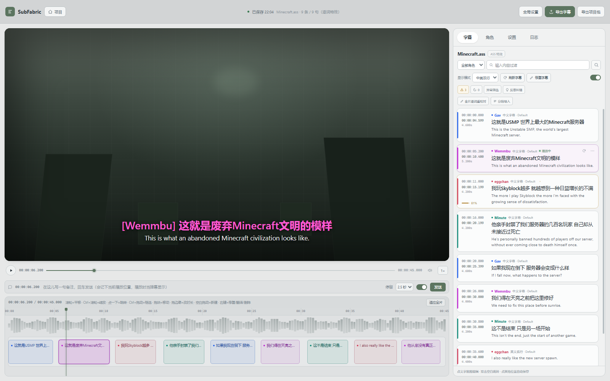

# 编辑器原型：只有右侧字幕卡被替换

打开 [index.html](index.html)。单文件、无外部依赖、无构建。

## 范围

除右侧字幕列表里的**字幕块（`.cue`）**和时间轴字幕块的**背景饱和度**外，编辑器其余部分保持当前生产界面的结构、浅色配色和控件密度：

- 顶栏：SubFabric、项目、保存状态、全局设置 / 导出字幕 / 导出项目包。
- 视频区、播放控制、备注条、波形/字幕块时间轴。
- 右侧：字幕 / 角色 / 设置 / 日志页签，文件头、角色筛选、搜索、显示模式、刷新/修复、异常/低置信筛选、全片重校对、分段导入。

因此这份原型用于单独评审「右侧字幕卡」改版，不评审整页重设计。

## 字幕卡规则

- **样式常驻**：`中文字幕 · Default` 始终显示，不依赖 hover（本轮反馈）。
- 角色名 + 颜色点、样式、播放中状态在同一信息行；样式用低对比小字号。
- 中文 12.5px / 1.5，英文 10.4px / 1.5；时间栏用等宽、低对比数字。
- 异常行只显示琥珀色图标；低置信度在时间栏底部显示百分比和细条。
- 重识别 / 更多操作在 hover、focus 或选中时出现；异常原因与诊断在展开区。
- 播放中：绿色呼吸点 + 文案 + 角色色左条；选中：卡片表面抬升 + 1px 亮边。
- **时间轴块背景降饱和**：角色色只以约 8% 混入中性灰（hover 12%、播放 15%），边框与文字仍保留角色色；仍能看出是谁的轨道，但不再抢字幕内容。

## 交互

- 播放 / 暂停；点击进度条或时间轴跳转；拖动进度条。
- 点击字幕卡选中并跳到该句；双击中英文就地编辑（Enter 保存、Esc 取消）。
- 悬停/聚焦出重识别与更多；异常图标展开原因；更多菜单含重排/翻译/删除。
- 搜索过滤、角色筛选、角色/设置/日志页签、空格播放/暂停、←/→ 1 秒。

## 预览

## 归档

上一版“整页暗色重设计”已保留为 [redesign-full-dark.html](redesign-full-dark.html)，仅作对比，不是本次交付方向。
