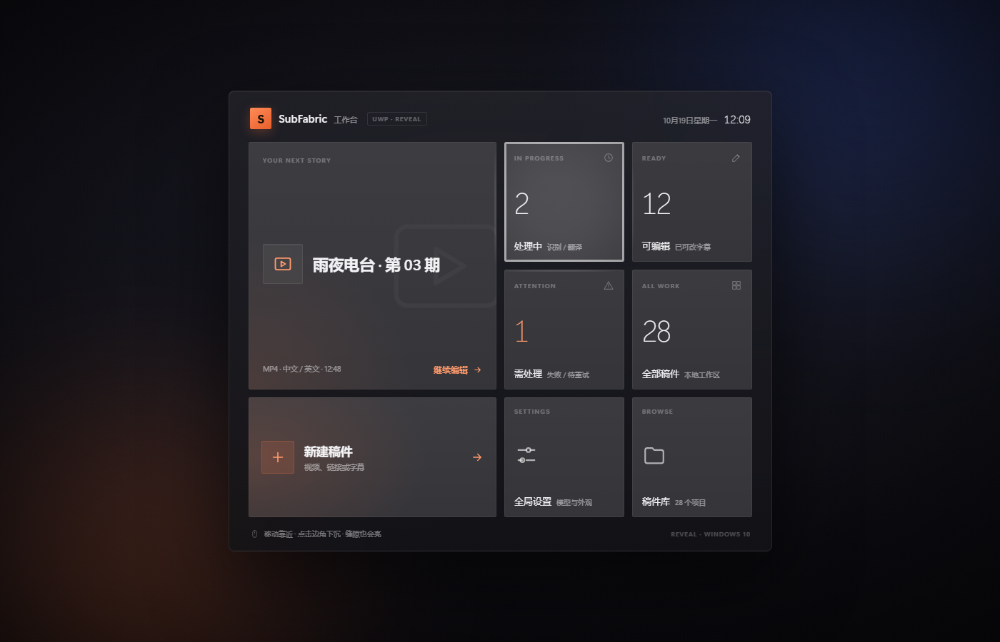
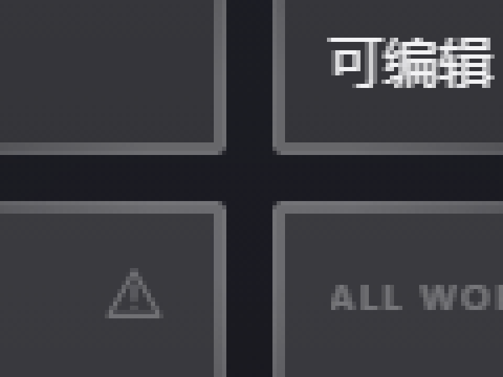
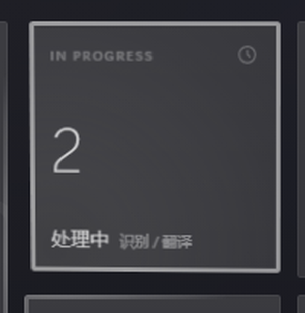
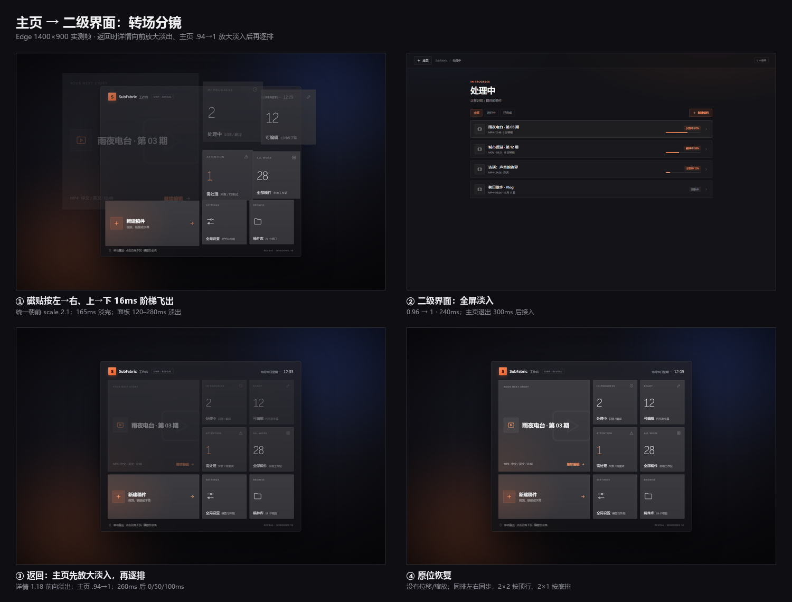
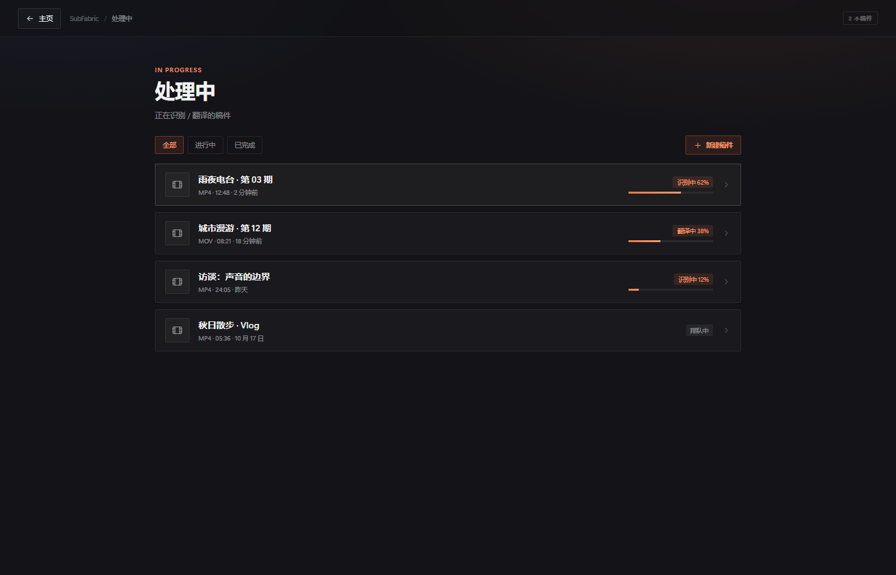

# UWP 磁贴工作台 · Win10 Reveal 光效

无构建、无依赖的单文件原型，直接打开 `index.html`。把现有 UWP 主页的 7 个小组件重排成 4×3 磁贴：继续编辑 2×2、新建 2×1，其余统计/入口 1×1，并补一个「稿件库」入口。2026-10-19 已实装到生产 UWP 主题（`studio.js`/`studio.css` 的磁贴层，见 STATUS）；本原型保留为设计评审与验收参考，数字、二级界面的列表/设置/新建仍是静态演示数据。

## 打开 / 演示

- 直接打开 `index.html`，移动鼠标即可。
- `index.html?demo=hover`：指针落在「处理中」磁贴内。
- `index.html?demo=gap`：指针停在四个 1×1 的十字缝隙，直接看边缘光。
- `index.html?demo=resume`：指针落在 2×2 大磁贴。
- 点击任意磁贴进入二级界面；Back / Esc 返回。
- 控制台可用 `window.__uwpTileDemo.setPointer(x,y)` / `.state()` / `.gap()` / `.tile(name)` / `.open(name)` / `.close()` / `.view()` 做验收。

## 光效（按上一轮截图实测实现）

- **悬停描边**：厚 2% T（168px → 3px）、50% 白、四边均匀；靠近指针的一侧会被下面的边缘光抬亮。
- **边缘光**：共享距离场，只画在 2% T 厚的边框上；峰值 25% 白，0–15% T 平台，0.72T 归零。指针在缝隙里也会亮，四格交叉处四块磁贴的边同时亮；缝芯不发光。
- **面光**：只给指针所在磁贴；径向，峰值 12%，半径 1.2×短边，半衰 ≈0.65T（按环带复核修正上一轮粗读的 0.55T），随磁贴尺寸缩放。
- 无外发光、无投影；不照亮亚克力底板、图标、文字和邻格填充。

## 点击：轻微下沉 + 边角局部下陷

- 按下 105ms：按落点归一化坐标 `(fx,fy)` 计算 `rotateX=(.5-fy)*2*maxTilt`、`rotateY=(fx-.5)*2*maxTilt`，`maxTilt=2.6°×168/max(w,h,168)`；`transform-origin` 放在落点的**对角**，所以对角保持、被点的边角沉下去；同时 `translateZ(-3px) scale(.99)`。
- 回弹 420ms：先反向过冲 20%（`scale(1.002)`、`translateZ(.6px)`），再回到 `none`；`::after` 在落点叠最多 20% 径向阴影 + 整卡 2.5% 压暗，只在按压/回弹期间可见。
- 中心点击不倾斜，只均匀下沉；`prefers-reduced-motion` 退化为仅压暗（2.5% + 落点阴影，不做 3D）。
- 验收：`__uwpTileDemo.press('processing', .1, .9)` / `.release()`；真实 pointerdown/up 同样触发。

## 主页 ⇄ 二级界面

- 点击任意磁贴进入全屏二级界面；按磁贴内容分为 list（处理中 / 可编辑 / 需处理 / 全部 / 稿件库）、resume、new、settings 四种。
- **打开**：主页面板**不缩放**，原地淡出（surface/头部 120–280ms）；以**屏幕中心**为透视原点，所有磁贴按网格比例整体 `scale 2.1` 向外铺开、飞出视口，`opacity` 在 36ms 后开始下降、**165ms 完全淡完**；退场顺序**按网格左→右、上→下，每块晚 16ms（0–112ms）**；被点磁贴置顶。300ms 后详情从 **0.96→1** 全屏淡入（240ms）。
- **返回**：详情整体向前放大到 1.18 并淡出（约 170ms，200ms 隐藏）；主页从 **.94→1** 放大淡入（260ms，surface/头部一起）；260ms 后衔接原有逐排：**底排 0ms、中排 50ms、顶排 100ms**，每块 180ms，只动 opacity，同排同步；底排满时顶排约 0.44；整段约 560ms。
- 2×2「继续编辑」按它的**顶行**（最后恢复）；2×1「新建」按**底排**（最先）。返回时磁贴不位移、不缩放，不从屏幕中心飞入。
- Back / Esc 返回，焦点回到被点磁贴；`prefers-reduced-motion` 退化。
- 验收：`__uwpTileDemo.open('processing')` / `.close()` / `.view()`。

## 间距与视觉

- `--gap: 11px`（T=168，约 6.5%）；Win10 参考 4px/100px（4%），现有 UWP 主页 4px。想更紧/更松只改这一个变量。
- 磁贴 2px 直角；面板 8px；深色 neutral surface + `#ff7a45` 强调色（新建、需处理、CTA、品牌）。
- 响应式：144 / 116 / 92 / 80px 四档，720px 以下 1×1 隐藏副标签，430px 以下隐藏 footer；720/480/400 宽实测无横向溢出。

## 文件与验证

- `index.html`：结构、样式、指针交互、演示钩子全部在一个文件里。
- `preview.png` / `preview-gap.png` / `preview-press.png`：悬停态、四格缝隙细节、左下角按压。
- `preview-transition.png` / `preview-detail.png` / `preview-open.png` / `preview-return.png`：转场分镜、二级界面、主页退出帧、返回中段。
- Edge headless 1400×900：页面无异常；`mouseMoved` 只命中 processing；`gap` 时四块磁贴均不 hover、`edgeOpacity=1`；1×1 `--face-r=201.6px`、2×2 `=416.4px`、`--glow-r=121px`、`--rim=3px`。
- 按压：按下时 `z-index=4`、`::after` 可见、transform 为倾斜矩阵；回弹结束 `transform:none`、origin 清空；真实 `mousePressed/Released` 与 `__uwpTileDemo.press/release` 都通过。
- 转场：真实点击进入 / Back 返回无异常；打开 100ms 暂停：面板 `transform:none`、surface 1、磁贴 `scale≈1.37`、opacity 0.26–1.0，行优先 delay 0/16/32/48/64/80/96/112ms；返回：详情 1.18 前向淡出、主页 .94→1，260ms 后 reveal 实测 top 0.444 / mid 0.722 / bottom 1.0（delay 100/50/0ms，整段约 560ms）；详情 4 行、new/settings/resume 模式正确；720/400 宽无横向溢出。
- 未跑完整 `tests/run-all.mjs`：本原型不涉及生产代码，浏览器渲染与交互检查即为本次验收。
